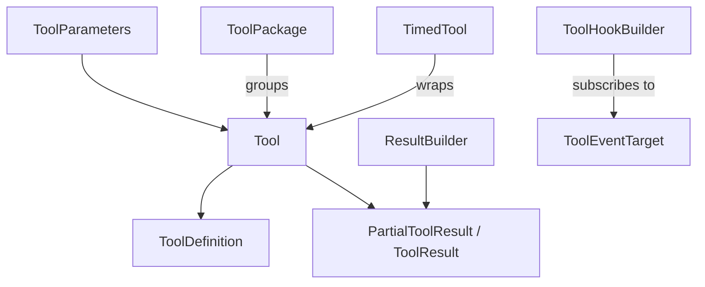

<a id="readme-top"></a>

<h1 align="center">@johannes.latzel/llm-chat-tool</h1>

<p align="center">
Provider-neutral tool, hook and result primitives with zero runtime dependencies.
</p>



[](https://opensource.org/licenses/MIT)
[](https://www.npmjs.com/package/@johannes.latzel/llm-chat-tool)
[](https://github.com/johanneslatzel/llm-chat-tool/releases)
[](https://www.typescriptlang.org/)
[](https://www.npmjs.com/package/@johannes.latzel/llm-chat-tool)
[](https://github.com/johanneslatzel/llm-chat-tool/pulls)
[](https://github.com/johanneslatzel/llm-chat-tool/discussions)
[](https://codecov.io/gh/johanneslatzel/llm-chat-tool)
[](https://github.com/johanneslatzel/llm-chat-tool/actions/workflows/ci.yml)
[](https://socket.dev/npm/package/@johannes.latzel/llm-chat-tool)
[](https://github.com/mefengl/made-by-ai)

<p align="center">
<a href="https://www.npmjs.com/package/@johannes.latzel/llm-chat-tool">npm</a>
&middot;
<a href="https://github.com/johanneslatzel/llm-chat-tool">GitHub</a>
&middot;
<a href="https://johanneslatzel.github.io/llm-chat-tool/">Docs</a>
&middot;
<a href="#quick-start">Quick start</a>
&middot;
<a href="https://johanneslatzel.github.io/llm-chat-tool/examples/">Examples</a>
&middot;
<a href="https://github.com/johanneslatzel/llm-chat-tool/issues">Issues</a>
&middot;
<a href="https://github.com/johanneslatzel/llm-chat-tool/releases">Releases</a>
</p>

<details>
<summary>Table of Contents</summary>

- [Why this package](#why-this-package)
- [Features](#features)
- [Prerequisites](#prerequisites)
- [Installation](#installation)
- [Quick start](#quick-start)
    - [Define a tool](#define-a-tool)
    - [Execute it](#execute-it)
    - [Bundle tools](#bundle-tools)
    - [Export a definition](#export-a-definition)
- [Parameters](#parameters)
    - [Factory methods](#factory-methods)
    - [Nested objects](#nested-objects)
    - [Hidden aliases](#hidden-aliases)
- [Results](#results)
    - [Multiple results](#multiple-results)
- [Tool packages](#tool-packages)
- [Timed tools](#timed-tools)
- [Tool hooks](#tool-hooks)
- [Documentation](#documentation)
- [Development](#development)
- [Scope](#scope)
- [License](#license)

</details>

## Why this package

`@johannes.latzel/llm-chat-tool` is a base package. It defines what a tool is,
how its inputs are described, what it returns, how related tools are grouped,
and how tool events are observed.

It has no runtime dependencies and performs no model calls, HTTP requests or
chat loops. A host application decides how to advertise `definition()` to a
model and when to call `execute()`.

## Features

- `Tool` base class with a neutral `definition()`
- JSON Schema parameters with nested objects, arrays, required fields and hidden aliases
- result chaining with `ResultBuilder`
- `ToolPackage` bundles with optional tutorial text
- lifecycle hooks for before, after and error events
- `TimedTool` wrapper for timeouts and cancellation
- zero runtime dependencies

## Prerequisites

| Requirement | Value |
|---|---|
| Node.js | >= 18 |
| Module format | ESM-only (no CommonJS build) |
| TypeScript | Optional; `.d.ts` files included |
| Runtime dependencies | none |

## Installation

```bash
npm install @johannes.latzel/llm-chat-tool
```

That is the only install required by this package. It has no peer or runtime
dependencies.

## Quick start

### Define a tool

```typescript
import {
    ResultStatus,
    Tool,
    ToolParameters,
    ToolParameterProperty,
    type PartialToolResult,
} from '@johannes.latzel/llm-chat-tool';

export class GreetTool extends Tool {
    constructor() {
        super(
            'greet',
            'Greets a person by name.',
            new ToolParameters(
                { name: ToolParameterProperty.string('Person to greet.') },
                ['name'],
            ),
        );
    }

    protected async onExecute(args: Record<string, unknown>): Promise<PartialToolResult> {
        this.validateRequiredParams(args, ['name']);
        return { result: `Hello, ${String(args.name)}!`, status: ResultStatus.Success };
    }
}
```

### Execute it

Call `execute()` like any async method. It returns one `ToolResult` per result
node:

```typescript
import { GreetTool } from './greet-tool.js';

const greet = new GreetTool();
const [result] = await greet.execute({ name: 'Ada' });

console.log(result?.status); // 'success'
console.log(result?.result); // 'Hello, Ada!'
```

The import targets `./greet-tool.js`: save the class above as `greet-tool.ts`
and this snippet as `greet.ts`, then run `npx tsx greet.ts`.

### Bundle tools

`ToolPackage` groups related tools and can describe how to use them:

```typescript
import { ToolPackage } from '@johannes.latzel/llm-chat-tool';
import { GreetTool } from './greet-tool.js';

export class GreetPackage extends ToolPackage {
    constructor() {
        super([new GreetTool()]);
    }

    tutorial(): string | null {
        return 'Use greet to welcome a user by name.';
    }
}
```

`tools()` returns the bundled instances, so a host can pick them up in one
step.

### Export a definition

`definition()` returns the neutral shape an adapter can translate into its own
model format:

```typescript
const definition = greet.definition();

// {
//     name: 'greet',
//     description: 'Greets a person by name.',
//     parameters: { type: 'object', properties: { ... }, required: ['name'] }
// }
```

[Back to top](#readme-top)

## Parameters

`ToolParameters` builds a JSON Schema object. The second constructor argument
lists required property names.

### Factory methods

```typescript
import { ToolParameterProperty } from '@johannes.latzel/llm-chat-tool';

ToolParameterProperty.string('A name')
ToolParameterProperty.number('A numeric value')
ToolParameterProperty.integer('An integer count')
ToolParameterProperty.boolean('A true/false flag')
ToolParameterProperty.array('A list of strings')
ToolParameterProperty.array('Scores', ToolParameterProperty.number('A score'))
ToolParameterProperty.object('A nested object')
```

The raw constructor accepts a `PropertyType` when you need it:

```typescript
import { PropertyType, ToolParameterProperty } from '@johannes.latzel/llm-chat-tool';

new ToolParameterProperty('Item count', PropertyType.Integer);
```

### Nested objects

`ToolParameterProperty.object(description)` returns an
`ObjectPropertyBuilder`:

```typescript
new ToolParameters({
    address: ToolParameterProperty.object('Mailing address')
        .addProperty('street', ToolParameterProperty.string('Street name'))
        .addProperty('city', ToolParameterProperty.string('City'))
        .addProperty('zip', ToolParameterProperty.integer('ZIP code'))
        .setRequired('street', 'city', 'zip')
        .build(),
}, ['address']);
```

### Hidden aliases

Models sometimes call an array parameter by a singular name. `.accepts(...)`
accepts aliases on input without advertising them in the schema:

```typescript
new ToolParameters(
    {
        paths: ToolParameterProperty.array('Files to read').accepts('path', 'file'),
    },
    ['paths'],
);
```

Aliases are removed before `onExecute` runs. A scalar alias for an array
parameter is wrapped in a one-element array. The canonical name always wins.

[Back to top](#readme-top)

## Results

A tool returns `PartialToolResult`:

```typescript
return { result: 'done', status: ResultStatus.Success };
return { result: 'could not read the file', status: ResultStatus.Error };
```

`Tool.execute()` catches thrown values, keeps the thrown value on
`ToolResult.error`, and expands a result chain into one `ToolResult` per node.
It emits no events itself: the host calls `execute()` and then emits `after` or
`error` for each result. Error hooks receive an `Error`, so a host coerces a
non-`Error` thrown value before emitting.

### Multiple results

`ResultBuilder` chains independent results. Each node becomes a separate tool
result for the caller:

```typescript
import { ResultBuilder, ResultStatus } from '@johannes.latzel/llm-chat-tool';

return ResultBuilder.from(
    matches.map((match) => ({
        result: match,
        status: ResultStatus.Success,
    })),
).build();
```

`build()` throws `ResultBuilder: no results added` when nothing was added, so
guard an empty collection before calling it.

`ResultBuilder.resolveAll(promises)` awaits many results and returns the
finished chain head.

[Back to top](#readme-top)

## Tool packages

`ToolPackage` groups related tools. Override `tutorial()` to describe when the
package applies and how to use it:

```typescript
class SupportPackage extends ToolPackage {
    constructor() {
        super([new GreetTool(), new LookupOrderTool()]);
    }

    tutorial(): string | null {
        return 'Use greet to welcome a customer and lookup_order to check an order.';
    }
}
```

If `tutorial()` returns `null`, the package contributes no tutorial text. The
host decides where that text appears.

[Back to top](#readme-top)

## Timed tools

`TimedTool` bounds how long the caller waits for one execution:

```typescript
import { TimedTool } from '@johannes.latzel/llm-chat-tool';

const controller = new AbortController();

const tool = new TimedTool(
    new SlowSearchTool(),
    30_000,
    () => controller.signal,
    (kind, message) => console.warn(kind, message),
);

const [result] = await tool.execute({ query: 'primitives' });
```

The constructor is `(inner, timeoutMs, signal, notify?)`. A non-positive
timeout disables the wrapper. A timeout or abort resolves as an error result;
the wrapper cannot force the inner tool to stop.

[Back to top](#readme-top)

## Tool hooks

`ToolHookBuilder` subscribes to before, after and error events on any object
that implements `ToolEventTarget`. The host owns the target and emits the
events:

```typescript
import { ToolHookBuilder, type ToolEventTarget } from '@johannes.latzel/llm-chat-tool';

// Provided by the host that emits tool events.
declare const events: ToolEventTarget;

const hooks = new ToolHookBuilder(events);

hooks.before().do((name, args) => {
    console.log('running', name, args);
});

const after = hooks.filter('greet').after().do((result) => {
    console.log('done', result.result);
});

after.dispose();
```

Each call returns a `Hook`; call `.dispose()` to unsubscribe. Before-hooks
receive the live argument object; after- and error-hooks are observers.

[Back to top](#readme-top)

## Documentation

Full documentation at **[johanneslatzel.github.io/llm-chat-tool/](https://johanneslatzel.github.io/llm-chat-tool/)**.

- [Overview](https://johanneslatzel.github.io/llm-chat-tool/)
- [Quick start](https://johanneslatzel.github.io/llm-chat-tool/quickstart/)
- [Defining tools](https://johanneslatzel.github.io/llm-chat-tool/tools/defining-tools/)
- [Registration](https://johanneslatzel.github.io/llm-chat-tool/tools/registration/)
- [Packages](https://johanneslatzel.github.io/llm-chat-tool/tools/packages/)
- [Timed tools](https://johanneslatzel.github.io/llm-chat-tool/tools/timed-tools/)
- [Tool hooks](https://johanneslatzel.github.io/llm-chat-tool/tools/tool-hooks/)
- [Examples](https://johanneslatzel.github.io/llm-chat-tool/examples/)
- [API reference](https://johanneslatzel.github.io/llm-chat-tool/api-reference/)
- [Architecture](https://johanneslatzel.github.io/llm-chat-tool/architecture/)

[Back to top](#readme-top)

## Development

```bash
git clone https://github.com/johanneslatzel/llm-chat-tool.git
cd llm-chat-tool
npm install
npm run verify
```

`npm run verify` runs the type check, lint, file-size checks, documentation
checks, and the test suite with coverage.

[Back to top](#readme-top)

## Scope

This package is deliberately self-contained:

- no runtime dependencies
- no model client, HTTP layer, chat loop or configuration loader
- no coupling to a specific model vendor or wire format
- tool definitions are neutral values; the host maps them to its own protocol

[Back to top](#readme-top)

## License

MIT. See [`LICENSE`](LICENSE).

## Contributing

Issues and PRs are welcome at
[github.com/johanneslatzel/llm-chat-tool](https://github.com/johanneslatzel/llm-chat-tool).
Use conventional commit messages.
