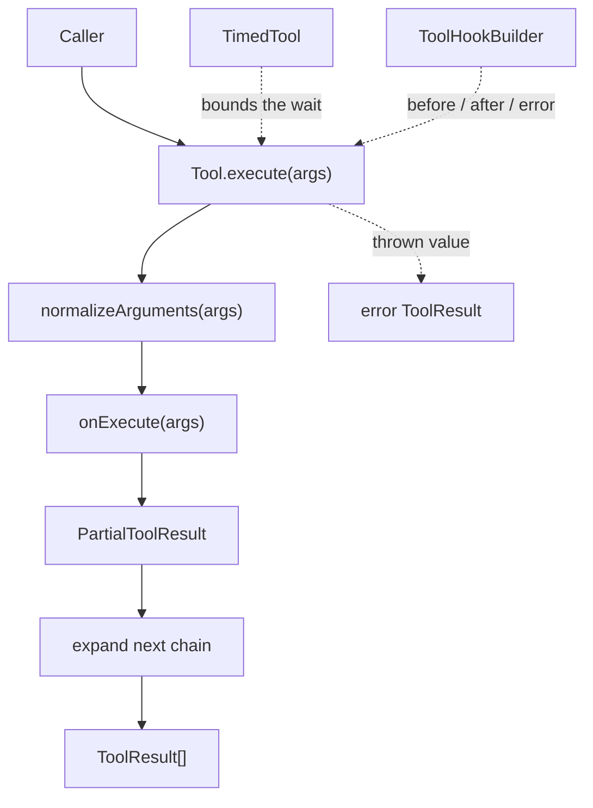

# Architecture

## Overview

`llm-chat-tool` is a base package. It owns the tool, hook and result
primitives and has no runtime dependencies. It does not open network
connections, read configuration or run a model.



## Components

| Component | Responsibility |
|---|---|
| `Tool` | name, description, parameter schema, execution |
| `ToolParameters` | JSON Schema input and alias normalization |
| `ToolParameterProperty` | one parameter and its nested shapes |
| `ResultBuilder` | chains multiple `PartialToolResult` values |
| `ToolPackage` | groups tools and optional tutorial text |
| `ToolHookBuilder` | subscribes to events on a `ToolEventTarget` |
| `TimedTool` | decorates a tool with a timeout and abort signal |

## Execution lifecycle

1. A caller invokes `Tool.execute(args)`.
2. `execute()` calls `normalizeArguments()`, which rewrites hidden aliases to
   their canonical names.
3. `onExecute()` runs inside a try-catch.
4. The returned `PartialToolResult` is expanded through its `next` chain.
5. The caller receives one `ToolResult` per node, each tagged with the tool
   name.

`execute()` is the only entry point that applies alias normalization and the
error boundary. Call `execute()` rather than `onExecute()`.

## Error boundary

A thrown value never escapes `execute()`. It becomes a single error result:

```typescript
{
    tool: 'read_file',
    result: 'Error: ENOENT: no such file or directory',
    status: ResultStatus.Error,
    error: originalThrownValue,
}
```

`ToolResult.error` keeps the original value for inspection after `execute()`;
error hooks receive an `Error` supplied by the host. A tool may therefore throw
or use `validateRequiredParams()` without breaking the caller.

## Parameters

`ToolParameters` builds a JSON Schema object. `ToolParameterProperty` describes
a property and supports nested objects, arrays, required fields and hidden
aliases. Aliases are accepted on input, never serialized, and removed before
`onExecute()` runs.

## Results

A tool returns `PartialToolResult`. A single result is the common case.
`ResultBuilder` links several results through the optional `next` field;
`execute()` expands the chain into one `ToolResult` per node.

## Packages

`ToolPackage` is a container with a `tools()` accessor and a `tutorial()`
method. It performs no registration. A host collects the tools and decides
where tutorial text is shown.

## Hooks

`ToolHookBuilder` registers callbacks on a `ToolEventTarget`. The target is
host-supplied and defines `on()` and `off()`. The builder returns `Hook`
instances whose `dispose()` unsubscribes. The package never emits events
itself.

## Timeouts

`TimedTool` wraps another tool, delegates `definition()`, and races the inner
execution against a timer and an abort signal. It resolves timeout and
cancellation as error results. A non-positive timeout disables the wrapper.
The wrapper cannot stop the inner tool; it only stops waiting.

## Dependencies

None at runtime. The package uses standard ECMAScript features only.
