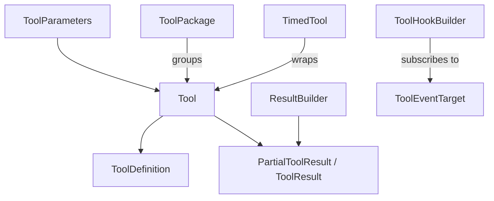

# Overview

Provider-neutral tool, hook and result primitives with zero runtime
dependencies.

`@johannes.latzel/llm-chat-tool` is a base package for TypeScript applications:
it defines tools, their schemas, results, packages and hooks, and performs no
model calls. A host decides how to advertise `definition()` to a model and
when to call `execute()`.

## What is included

- `Tool` and the neutral `ToolDefinition`
- JSON Schema parameters with nested objects, arrays, required fields and hidden aliases
- result and error chaining with `ResultBuilder`
- `ToolPackage` bundles with optional tutorial text
- tool lifecycle hooks
- `TimedTool` for timeouts and cancellation

## Navigation

- [Quick start](quickstart.md) - define, execute and bundle a tool
- [Tools](tools/index.md) - defining, registration, packages, timed tools and hooks
- [Examples](examples/index.md) - runnable tool scenarios
- [Architecture](architecture.md) - internal execution model
- [API Reference](api-reference.md) - classes, types and enums

## Scope

This package defines tools; it does not run a model. A host application reads
`definition()`, calls `execute()`, and decides how results are presented.

## License

MIT. See [`LICENSE`](https://github.com/johanneslatzel/llm-chat-tool/blob/main/LICENSE).
