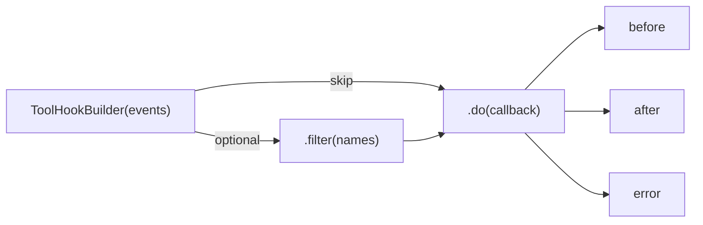

# Tool hooks

`ToolHookBuilder` subscribes before, after and error callbacks to any object
that implements `ToolEventTarget`. This package does not emit events and does
not run tools; the host emits events around execution.



## Event target

The target only needs `on()` and `off()`. A minimal host implementation:

```typescript
import {
    ToolEvent,
    type ToolEventMap,
    type ToolEventTarget,
} from '@johannes.latzel/llm-chat-tool';

type Handler = (...args: never[]) => void;

class ToolEvents implements ToolEventTarget {
    private handlers = new Map<ToolEvent, Set<Handler>>();

    on<E extends ToolEvent>(event: E, handler: (...args: ToolEventMap[E]) => void): void {
        const set = this.handlers.get(event) ?? new Set<Handler>();
        set.add(handler as Handler);
        this.handlers.set(event, set);
    }

    off<E extends ToolEvent>(event: E, handler: (...args: ToolEventMap[E]) => void): void {
        this.handlers.get(event)?.delete(handler as Handler);
    }

    emit<E extends ToolEvent>(event: E, ...args: ToolEventMap[E]): void {
        for (const handler of this.handlers.get(event) ?? []) {
            (handler as (...values: ToolEventMap[E]) => void)(...args);
        }
    }
}
```

## Subscribe

```typescript
import { ToolHookBuilder } from '@johannes.latzel/llm-chat-tool';

const events = new ToolEvents();
const hooks = new ToolHookBuilder(events);

// fires for ALL tools
hooks.before().do((name, args) => {
    console.log(`Running ${name}`);
    args.injected = 'context'; // mutations affect the tool
});

// fires only for 'greet'
const after = hooks.filter('greet').after().do((result) => {
    console.log(`Done: ${result.result}`);
});

const onError = hooks.error().do((name, error) => {
    console.error(`Failed ${name}: ${error.message}`);
});

after.dispose();
onError.dispose();
```

`.filter(...names)` restricts which tools fire the hook. Each `.do()` returns a
`Hook`; call `.dispose()` to unsubscribe. Disposal is idempotent.

## Semantics

The host emits each event with the tuple from `ToolEventMap`, so the values it
passes must match the handler signature:

| Event | Host passes |
|---|---|
| `ToolEvent.Before` | `name` and the very argument object it will hand to `execute()`, so in-place mutations reach the tool |
| `ToolEvent.After` | one `ToolResult`; the `llm-chat` engine emits it once per successful result node |
| `ToolEvent.Error` | `name` and an `Error`: the thrown value when it is an `Error`, a wrapper around any other thrown value, or an `Error` built from the failed result's `result` string |

`ToolResult.error` is set only by the error boundary for thrown values. A tool
that returns `{ status: ResultStatus.Error }` therefore produces a result
without `error`, and the host still fires the error event: it has to supply an
`Error` of its own, which is what the engine does by wrapping `result.result`.
Error-hooks always receive an `Error`; only the thrown case carries the original
value, and only when that value already is an `Error`.

- After- and error-hooks are observers; mutations do not affect the result.
- The hook awaits async handlers itself; the caller waits for them only when the
  host awaits `emit()`.
- Callback errors are caught and logged with
  `console.error('Hook callback error:', err)`; they do not escape the hook.
  `ToolHookOptions` is `{ tools?: string[] }`, so the package exposes no option
  to silence or redirect that log.

```typescript
import { ResultStatus, ToolEvent } from '@johannes.latzel/llm-chat-tool';

events.emit(ToolEvent.Before, 'greet', { name: 'Ada' });
events.emit(ToolEvent.After, {
    tool: 'greet',
    result: 'Hello, Ada!',
    status: ResultStatus.Success,
});
```

## See also

- [Defining tools](defining-tools.md)
- [Timed tools](timed-tools.md)
- [Executing a tool](../examples/executing-tools.md)
